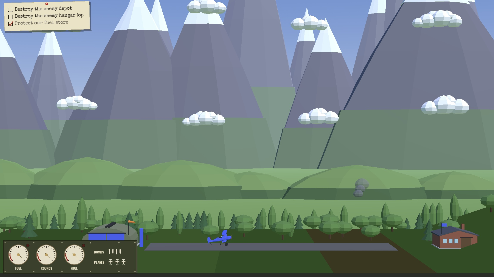

# Plane Trip

A single-player, side-view aerial combat game in the spirit of Triplane Turmoil. Fit your triplane out with bomb racks, ammunition, fuel and armour, take off, dogfight AI pilots, bomb their depot under flak, and land to rearm and go again. Flat-shaded WW2 models, a dance band on the wireless, and it plays in the browser.

This is a Ludum Dare 60 Jam entry.

**[Play it in the browser](https://carrollallenrobin.github.io/plane-trip/)**



Built with Godot 4.7 and GDScript. Every model is a Blender script, every sound a synthesis script and the UI's shapes are hand-written SVG; there is no imported art and no recorded sample in the repository.

## Playing

Pick a mission, fill the six slots of the Refit screen, and fly. Everything you carry slows the plane. Land on your own runway and stop to rearm; the fight goes on behind the Refit screen. You win by completing every required objective and lose when a protected target falls or you run out of planes.

| Action | Keyboard | Gamepad |
|---|---|---|
| Pitch up / down | Down / Up (pull back to climb) | Left stick back / forward |
| Half-roll | Left or Right | B |
| Thrust (hold) | Shift | Right shoulder |
| Air brake | Up and Down together | |
| Fire | Z | A |
| Bomb | X | X |
| Pause | Escape | Start |

Menus take the arrow keys and Enter, or the stick and A. A few things worth knowing:

- Taking off: hold thrust, push to lift the tail, pull once you have speed.
- A half-roll flips the plane and swaps the pitch controls. Fuel burns only while thrusting.
- Bombs leave the belly with your speed, so aim from the plane's path.
- Landing needs wheels down, right side up and the nose roughly level. Speed does not matter.
- Water, the ground and the edges of the world destroy the plane. Above the ceiling it tumbles until it falls back under.

## Running it yourself

Playing and testing need only Godot. Blender and Python are for rebuilding the art.

- **Godot 4.7.2**: install it and set `GODOT_BIN`, or let `scripts/fetch-godot.sh` download the pinned build into `.tools/godot/` the first time a script needs it.
- **gdtoolkit 4.5.0** for formatting and linting: `uv tool install gdtoolkit==4.5.0`, with [uv](https://docs.astral.sh/uv/).
- **Blender 5.0.1**, only to rebuild models after editing `art/models/` (see `docs/modelling.md`). Set `BLENDER_BIN` or let `scripts/fetch-blender.sh` fetch it. The built `.glb` files are committed.
- **uv** also runs the sound scripts with pinned numpy and matplotlib. The built `.wav` files are committed.
- **gdUnit4** is vendored in `addons/gdUnit4`.

Open `project.godot` in the editor and press F5 for the title screen, or run a mission scene from `missions/` with F6. F3 shows the debug overlay.

```sh
scripts/play-web.sh [--debug]        # export the Web build and serve it on http://localhost:8765
scripts/test.sh                      # all gdUnit4 suites, headless; -a res://test/flight for one directory
scripts/lint.sh [--fix]              # gdformat and gdlint; --fix reformats in place
scripts/import.sh                    # headless resource import, after adding assets
scripts/build-models.sh [name]       # Blender: art/models/*.py -> assets/models/*.glb
scripts/preview-model.sh plane       # render a built model to .tools/preview/plane.png
scripts/build-sounds.sh [family]     # Python: art/sounds/*.py -> assets/audio/*.wav
scripts/preview-sound.sh engine      # waveform and spectrogram to .tools/preview/engine.png
scripts/build-cover.sh               # render the store-page covers into promo/
scripts/fetch-fonts.sh               # refresh assets/fonts/ from the pinned Google Fonts commit
scripts/export-web.sh [--debug]      # Web export to build/webgl/
scripts/serve-web.sh [port]          # serve build/webgl/ with cross-origin isolation headers
scripts/fetch-export-templates.sh    # install the Web export templates for the pinned Godot
```

The Web build runs with threads, so it needs cross-origin isolation. `scripts/serve-web.sh` sends the headers. A host that cannot, including GitHub Pages, still runs the build: the export is a progressive web app and its service worker adds the headers. The export templates are about 1.3 GB, downloaded once. Test reports land in `reports/`.

## How it is put together

The simulation is pure GDScript with no nodes: a `World` steps planes, projectiles, guns and mission rules in 2D and returns events. Godot nodes render it in 3D, feed it input and play what the events say. Models, sounds and the store covers are generated from scripts and committed as built files.

```
src/sim/          the simulation: flight, combat, ground, mission rules
src/game/         Godot nodes around it, the instrument panel, the menus
missions/         one scene per mission
data/             the airframe, fittings, loadouts, flight tuning
art/              model scripts, sound scripts, the UI's SVG shapes, the cover script
assets/           built models, built sounds, fonts with their licences
test/             gdUnit4 suites, mirroring src/
docs/             design notes, ADRs, research on the original game
promo/            store-page covers and pitch; ignored by Godot
```

For the reasoning behind it: [`CONTEXT.md`](CONTEXT.md) is the glossary, [`docs/design.md`](docs/design.md) the settled design, [`docs/adr/`](docs/adr/) the architecture decisions, and [`docs/research/triplane-classic-mechanics.md`](docs/research/triplane-classic-mechanics.md) how the original worked.

## Releasing

Every push to `main` runs `.github/workflows/deploy.yml`: lint, tests, the Web export, then a deploy to [GitHub Pages](https://carrollallenrobin.github.io/plane-trip/). Pages must be set to build from GitHub Actions (Settings → Pages → Build and deployment → Source: GitHub Actions); the first run fails until that is set. A public repository can use Pages on the free plan. A private one needs GitHub Pro or higher.

Upgrading tools:

- Godot: `GODOT_VERSION` in `scripts/fetch-godot.sh`, `scripts/fetch-export-templates.sh` and the workflow, and `config/features` in `project.godot`.
- gdUnit4: replace `addons/gdUnit4` with the folder from a newer [release](https://github.com/godot-gdunit-labs/gdUnit4).
- gdtoolkit: `uv tool install gdtoolkit==<version>`, then the workflow and this README.
- Fonts: the commit and hashes in `scripts/fetch-fonts.sh`; run it and commit the files.
- numpy and matplotlib: the pins in `scripts/sound-env.sh`.

## Licence

MIT, see [`LICENSE`](LICENSE). The vendored gdUnit4 and the fonts under `assets/fonts/` carry their own licences beside them.

## Links

- [itch.io page](https://boids.itch.io/plane-trip)
- [Game page](https://ldjam.com/events/ludum-dare/60/plane-trip)
- [Game Jam page](https://ldjam.com/events/ludum-dare/60)

## Author

Jari Helenius

[![LinkedIn][linkedin-shield]][linkedin-url]

<!-- MARKDOWN LINKS & IMAGES -->

[linkedin-shield]: https://img.shields.io/badge/-LinkedIn-black.svg?style=for-the-badge&logo=linkedin&colorB=555
[linkedin-url]: https://linkedin.com/in/jari-helenius-a445478a